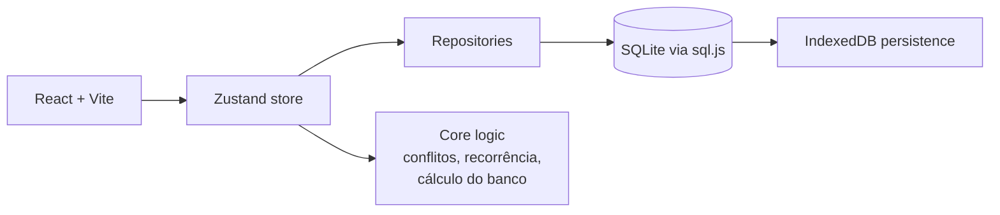

# SortALazyCronos

Aplicativo pessoal de gestão de tempo para planejar a semana, bloquear dias, organizar atividades recorrentes e controlar um banco de horas livres. O projeto combina cronograma semanal, rotinas automáticas e mecanismo de comprometimento para reduzir o custo de adiar tarefas importantes.

## Funcionalidades

- Cronograma de 7 dias com navegação semanal e destaque do dia atual.
- Cadastro e organização de atividades por categoria:
  - rotineiras fáceis (horário fixo recorrente)
  - rotineiras sem horário fixo
  - atividades com prazo fixo
  - atividades sem prazo
- Geração automática de blocos para rotinas fáceis quando o dia ainda não possui agendamento.
- Bloqueio e desbloqueio de dias para transformar espaços vazios em "Tempo Livre".
- Banco de horas livres com registro de movimentação e alerta visual para saldo negativo.
- Inclusão de imprevistos em dias trancados, com reuso do banco ou realocação do tempo livre.
- Marcação de conclusão de blocos e acompanhamento do status do cronograma.
- Persistência local em SQLite, salva no navegador via IndexedDB.
- Tema claro/escuro e configurações pessoais do app.

## Tecnologias utilizadas

- React 19
- TypeScript
- Vite
- Zustand
- Kysely
- sql.js
- Tailwind CSS
- @dnd-kit (bibliotecas de drag-and-drop)
- Tauri (configuração presente em `src-tauri/tauri.conf.json`, mas sem scripts dedicados confirmados no `package.json`)

## Pré-requisitos

Para rodar o projeto localmente, o ambiente precisa ter:

- Node.js + npm instalados
- Um navegador moderno para abrir a aplicação em desenvolvimento

> O repositório não contém `.env.example` nem variáveis de ambiente configuradas. O app persiste dados localmente e não depende de banco externo no MVP.

## Instalação e configuração

Clone o repositório e instale as dependências:

```bash
npm install
```

Não há arquivo de ambiente com variáveis obrigatórias no projeto. A configuração do banco e do estado do app acontece em código, com criação automática de tabelas e persistência em IndexedDB.

## Como executar

### Desenvolvimento

```bash
npm run dev
```

Este comando inicia a aplicação em modo de desenvolvimento. O projeto principal é um front-end web em Vite e também possui configuração do Tauri para empacotamento desktop, mas a build validada no repositório foi a do fluxo Vite.

### Build de produção

```bash
npm run build
```

### Preview da build

```bash
npm run preview
```

> Não foi identificado Dockerfile, docker-compose.yml ou script de containerização no projeto.

## Como rodar os testes

Não há testes automatizados configurados no repositório no momento. O único comando de validação confirmado no código foi:

```bash
npm run build
```

A build foi executada com sucesso no ambiente atual.

## Estrutura do projeto

```text
.
├── src/
│   ├── components/
│   │   ├── activities/          # painéis e modais de criação/edição de atividades
│   │   ├── bank/                # modal do banco de horas
│   │   ├── header/              # cabeçalho da aplicação e navegação semanal
│   │   ├── schedule/            # grid do cronograma e modais de alocação
│   │   └── settings/            # modal de configurações
│   ├── core/
│   │   ├── bank/                # regras de cálculo do banco de horas
│   │   ├── routine/             # recorrência e geração de blocos automáticos
│   │   └── schedule/            # utilitários de tempo, conflitos e duração
│   ├── database/
│   │   ├── repositories/        # acesso ao SQLite local por entidade
│   │   ├── kysely.ts            # inicialização do banco sql.js + IndexedDB
│   │   └── schema.ts            # schema inicial das tabelas
│   ├── stores/
│   │   ├── useActivitiesStore.ts # estado das atividades
│   │   └── useScheduleStore.ts  # estado do cronograma, lock/unlock e banco
│   ├── types/
│   │   └── index.ts             # tipos compartilhados do domínio
│   ├── App.tsx                 # composição principal da interface
│   ├── main.tsx                # entry point do React
│   └── index.css               # estilos globais e tokens visuais
├── src-tauri/
│   └── tauri.conf.json         # configuração do wrapper desktop do Tauri
├── dist/                       # build de produção gerada pelo Vite
├── package.json                # dependências e scripts do projeto
├── package-lock.json           # lockfile do npm
├── tsconfig.json               # configuração TypeScript
├── vite.config.ts              # configuração do Vite
├── tailwind.config.js          # configuração do Tailwind
├── postcss.config.js           # configuração do PostCSS
├── .gitignore                  # ignora artefatos comuns
├── prompt.md                   # instruções do projeto / prompt de desenvolvimento
└── README.md                   # documentação do projeto
```

## Uso / exemplos

### Fluxo principal

1. A tela inicial carrega o cronograma dos próximos 7 dias.
2. O usuário cria atividades nas abas do painel inferior.
3. Cada atividade pode ser alocada no cronograma por data e intervalo de horário.
4. O dia pode ser trancado para transformar lacunas em "Tempo Livre".
5. O banco de horas registra ganhos e perdas ao mover ou remover blocos em dias trancados.

### Exemplo de uso no app

- Cadastrar rotina fácil: "Dormir" de 22:00 a 06:00, com recorrência diária.
- Cadastrar atividade com prazo: "Entregar revisão de documentação" com data limite.
- Trancar um dia para consolidar o planejamento e transformar tempos vazios em blocos livres.
- Inserir um imprevisto em um dia trancado para substituir tempo livre e atualizar o banco de horas.

<!-- TODO: confirmar screenshots ou vídeos de uso para ampliar a documentação -->

## Arquitetura / decisões técnicas



Principais decisões observadas no código:

- Persistência local por design: sem backend e sem sincronização em rede no MVP.
- Uso de SQLite em navegador por meio de `sql.js`, com criação de schema inicial em `src/database/schema.ts`.
- Organização em stores para separar cronograma e atividades de negócio.
- Regras de domínio centralizadas em módulos `core/` para cálculo de horário, recorrência e saldo do banco.

## Obersavação

- O sistema foi criado com auxílio de *vibe coding* e apresenta bastantes bugs

<!-- TODO: confirmar contato do autor ou política de contribuição -->
